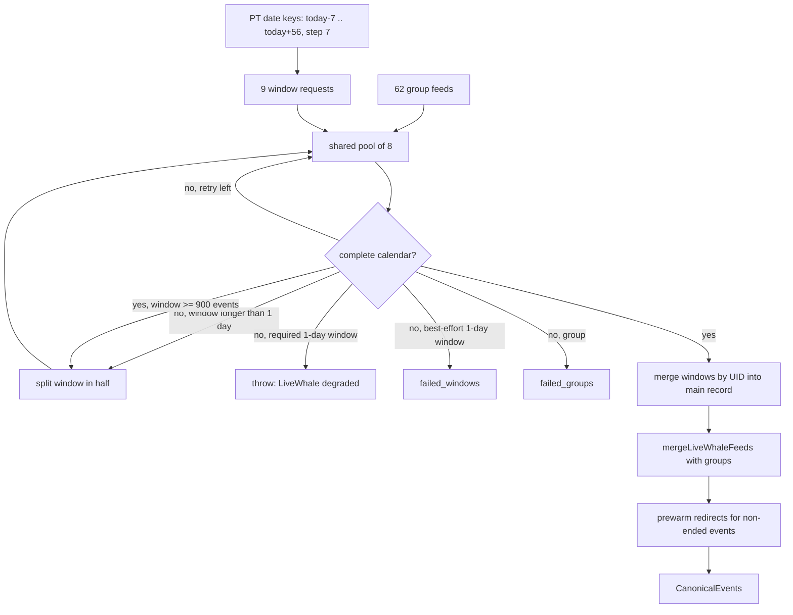

# LiveWhale Windowed Feed and Wider Department Coverage - Plan

## Goal Capsule

- **Objective:** cal-events.com keeps publishing UC Berkeley campus events every day, shows the campus calendar about eight weeks ahead instead of about two, and lists events from 22 more departments and research centers.
- **Means:** fetch the LiveWhale main feed as consecutive weekly date windows checked for completeness (KTD1, KTD2), and add verified department group feeds (KTD7).
- **Authority:** this plan's R-IDs win on behavior, KTDs win on mechanism. The repo's AGENTS.md publish and alerting rules stay binding.
- **Execution profile:** one pull request, units U1 to U6 in order. Ship target is a merge to `main` before the 2026-10-31 daily run, then one manual `update-events` run.
- **Stop conditions:** stop if a live run shows one-day windows returning incomplete calendars, or if the adapter cannot finish inside its time budget on a real fetch.
- **Who finishes:** `ce-work` implements. The pipeline reviews, merges, and triggers the data run.

---

## Product Contract

### Summary

The LiveWhale adapter stops relying on the single default feed URL. It fetches one week back and eight weeks ahead as weekly date windows, checks that every response is a complete calendar, and merges the results by UID. Twenty-two verified department and research-center group feeds join the existing 40. Status reporting gains a list of best-effort windows that failed.

### Problem Frame

LiveWhale supplies about 1,300 of the site's ~1,450 events and is the only source whose failure blocks publishing. Since about 05:40 UTC on 2026-10-30, `https://events.berkeley.edu/live/ical/events` returns a body cut off at 237,127 bytes, ending mid-event with no `END:VCALENDAR`. node-ical parses that as 0 events, so the adapter throws. The cut falls at `SUMMARY:` right before an event whose title holds a 4-byte emoji ("🏈 Chapters Watch Party", 2026-10-31). Repeating the request, with or without a cache-busting query, returns the same cut body. Some date-window requests that contain the event are cut the same way, while smaller windows containing it render completely. The 2026-10-29 17:16 UTC cron run was healthy.

The default feed also silently caps at about 969 events, which reaches only about two weeks ahead. Published LiveWhale rows run 25 to 91 a day through 2026-11-11 and then drop to 0 to 9 a day. Department events beyond two weeks appear only when a group feed carries them.

Separately, a coverage sweep of all 287 LiveWhale groups found 22 active groups the adapter does not fetch. Examples are the Townsend Center, Molecular and Cell Biology, Berkeley Public Health, BIDS, and QB3.

If every cron fails from now on, LiveWhale's last-good fallback (48 h, aged from `last_healthy_at` 2026-10-29T17:16Z) expires around 2026-10-31 17:16 UTC, and publishing blocks.

### Requirements

**Reliable main feed**

- R1. A truncated or non-calendar LiveWhale response is treated as a failed fetch and retried, never parsed as an empty calendar.
- R2. A failure in the near-term coverage (one week back through two weeks ahead) degrades LiveWhale exactly as a main-feed failure does today.
- R3. A failure in a later window does not degrade LiveWhale, and it appears in `status.json` on the LiveWhale entry.
- R4. A quiet week with few events, such as winter break, never fails the source.

**Wider coverage**

- R5. Published LiveWhale events cover from one week back through eight weeks ahead, with no day lost at window boundaries.
- R6. Events from the 22 verified groups in KTD7 are fetched, merged, and carry their group membership.
- R7. Events that started before today and are still running remain published.

**Operations**

- R8. A normal LiveWhale run finishes well inside its adapter time budget.
- R9. The weekly source-contract check fails when the LiveWhale feed is truncated.

### Key Decisions

- **Ship this release by merging to `main`.** (session-settled: user-directed — chosen over leaving the PR open for later review: the user said "merge" and asked to ship this release.)
- **Use standard machine-readable feeds, not HTML scraping.** Governs R5, R6. (session-settled: user-directed — chosen over HTML scrapers for sites without feeds: the user asked for a more stable mechanism.)
- **Eight weeks ahead.** Governs R5. Weekly volume after week 3 is 43 to 167 events, and Recreational Sports rows stop after 2026-11-23, so the added noise is small.

### Scope Boundaries

- Filtering Recreational Sports "Building Hours" rows is not part of this change.
- CalLink stays broken. Its site now requires a CampusLabs login.
- CITRIS, SCET, and Berkeley Lab return 403 to automated requests. They are not bypassed.
- Staff and professional-audience groups (Extension, HR, University Health Services, Retirement Center) and daily exhibit-instance groups are not added.
- **Considered and not built:**
  - A separate consecutive-failure alert for best-effort windows. `failed_windows` in `status.json` plus a log warning is enough while the near-term windows stay required. A best-effort window failing for days in a row would change this call.
  - Raising `LIVEWHALE_HEALTHY_THRESHOLD` above 100. The required windows already throw on failure, so the threshold is not the signal. Repeated low counts with all windows healthy would change this call.
  - An automatic fallback to the old default URL. It covers only two weeks, so it would shrink coverage.

### Deferred to Follow-Up Work

- Filter or down-rank Recreational Sports "Building Hours" rows.
- Replacement-character mojibake in some LiveWhale descriptions (about 60 per weekly window), which predates this change.

---

## Planning Contract

### Key Technical Decisions

- KTD1. **Consecutive half-open weekly windows.** Build date keys from the PT date with `todayPT()`, starting 7 days back and stepping 7 days to 56 days ahead, and fetch each consecutive pair as `/live/ical/events/start_date/<a>/end_date/<b>`. LiveWhale treats `end_date` as exclusive for timed events. Pairs that share keys therefore lose no day, and the boundary-day all-day rows that appear twice merge by UID. Do date arithmetic on `YYYY-MM-DD` values with `Date.UTC`, never by adding milliseconds to a local midnight, so DST changes (2026-11-01, 2027-03-14) cannot shift a key. The 7-day lookback keeps still-running events that started earlier (R7). Ended events are dropped by the existing `endedBeforePT`.
- KTD2. **A complete calendar replaces the per-request count floor.** Every LiveWhale response, main window or group, must contain `BEGIN:VCALENDAR` and end, after trailing whitespace, with `END:VCALENDAR`. Otherwise the fetch failed. Repeating the same URL returns the same cut body, so an incomplete window is split (KTD4) after one retry rather than retried further. Windows have no per-request minimum event count, so winter weeks of 43 to 46 events pass (R4). `MIN_HEALTHY_EVENT_COUNT` (50) applies to the merged total of the required windows.
- KTD3. **Required and best-effort windows.** The lookback window and the first two forward windows are required. If any fails after retries, the adapter throws, as the single-URL fetch does today (R2). Later windows are best-effort. Their failures are collected as `failedWindows` (the window's start key) and published as `failed_windows` on the LiveWhale status entry, beside `failed_groups` (R3).
- KTD4. **Split a capped or incomplete window.** A window that is still incomplete after its retry, or that returns 900 or more VEVENTs, is refetched as two halves, recursively, down to one day. A one-day window that stays incomplete is that window's failure under KTD3. A one-day window still at 900 or more logs a warning. On 2026-10-30 a truncated window (2026-10-30 to 2026-11-06) came back complete as two halves. The silent cap returned 926 to 968 events in probes, and the busiest observed week holds 526.
- KTD5. **One request pool and a LiveWhale time budget.** Windows and group feeds share one bounded pool of 8 concurrent requests, matching `GROUP_FEED_CONCURRENCY`, so the host sees no more parallel connections than today. Each LiveWhale request gets a 15 s timeout and 2 attempts. LiveWhale gets its own adapter timeout of 90 s, the same way Simons has `SIMONS_ADAPTER_TIMEOUT_MS`.
- KTD6. **Redirect resolution scales with event count.** Raise the `redirectSlugCache` eviction cap well above the expected count of unique `/live/events/` URLs (about 400 to 600 for nine windows). Prewarm only events that have not ended. The serial `unitFromUrl` loop then reads warm entries.
- KTD7. **Group names are LiveWhale fullnames, verified live.** Each of these returned a complete calendar with more than 0 events on 2026-10-30: Featured Events; Haas School of Business; Townsend Center for the Humanities; Molecular and Cell Biology; Theater, Dance, and Performance Studies; College of Letters & Science; Berkeley Public Health; Industrial Engineering and Operations Research; Berkeley Initiative of Behavioral Science (BIBS); QB3; Berkeley Institute for Data Science; College of Computing, Data Science, and Society; Global, International and Area Studies; Rausser College of Natural Resources; Civil and Environmental Engineering; Electrical Engineering & Computer Sciences; Fung Institute for Engineering Leadership; Comparative Literature; Materials Science and Engineering; Folklore; Space Sciences Laboratory; Tang Center for Silk Road Studies. A wrong name, for example "and" instead of "&", returns a valid empty calendar, so the names are copied exactly.
- KTD8. **`source_url` stays `FEED_URL`.** It is only a fallback after `canonical_url` in `projectToLegacy`, so window URLs never reach published data.
- KTD9. **The source contract probes a one-week window.** The `livewhale` contract in `scripts/lib/sourceContracts.mjs` fetches a 7-day window starting today (UTC date is fine there) and requires `END:VCALENDAR`, instead of the default URL with a 10,000-byte check.

### High-Level Technical Design

### Assumptions

- The upstream truncation is tied to response content and size, not to caching. Splitting a truncated window into smaller windows has recovered a complete calendar in every probe so far.
- Output grows to roughly 2.0 to 2.2 MB for `events.json` and 650 to 750 KB for `search-index.json`. Both stay under the 4 MiB `events.json` budget enforced in `validate.yml`. The first real run measures this.
- LiveWhale volume stays under `MAX_EVENTS_PER_SOURCE` (5000). The estimate is 2,000 to 2,500 merged events.
- Featured Events is kept unless the implementation run finds fewer than 10 of its UIDs outside the windows. It is probably a near-subset of the main feed.

### Sources

- Research dossiers from this planning run: `/tmp/compound-engineering-501/ce-plan-research/caf083af/repo-research.md`, `learnings.md`, `spec-flow.md` (machine-local).
- Group coverage sweep: `/private/tmp/claude-501/-Users-akhilneelam/5d1b9fd4-186d-4072-b0a7-e35009aaa050/scratchpad/coverage/groupcov.tsv` (machine-local).
- `docs/solutions/integration-issues/livewhale-group-feed-failure-wiped-topics.md`: failed groups keep prior topics, and group failures never degrade LiveWhale.

---

## Implementation Units

### U1. Windowed main feed with completeness check

- **Goal:** Replace the single main-feed fetch with the windowed fetch (KTD1 to KTD4), and apply the completeness check to every LiveWhale request.
- **Requirements:** R1, R2, R3, R4, R5, R7.
- **Dependencies:** none.
- **Files:**
  - `scripts/sources/livewhale.ts`
  - `scripts/tests/livewhale-windows.test.mjs` (new)
  - `scripts/tests/multi-day-spans.test.mjs`
  - `scripts/tests/topics.test.mjs`
- **Approach:**
  1. Add a pure, exported helper that builds the window key list from a PT date key, and one that builds a window URL.
  2. Split `fetchFeed`'s two roles. Today `minEvents === 0` doubles as the group switch. Give windows and groups an explicit completeness-checked fetch with no count floor (KTD2), and keep the count floor only on the merged required-window total.
  3. Merge window results by UID into one main record before calling `mergeLiveWhaleFeeds`, so window names never reach `livewhale_groups` or `failed_groups`.
  4. Return `failedWindows` from `fetchLiveWhale` beside `failedGroups`.
  5. Route windows and groups through one pool (KTD5).
- **Patterns to follow:** `fetchAllGroupFeeds` bounded pool; `mergeLiveWhaleFeeds` UID merge; the group-failure handling in `docs/solutions/integration-issues/livewhale-group-feed-failure-wiped-topics.md`.
- **Test scenarios:** all with stubbed `fetch` serving frozen iCal text, never the live feed.
  - Window keys for PT date 2026-10-29 run from 2026-10-22 to 2026-12-24 in 7-day steps, 10 keys and 9 windows.
  - Window keys across the 2026-11-01 DST change and from a 2027-03-10 start stay exact calendar dates.
  - A timed event served only by the window that starts on its date is published once (boundary day not lost).
  - An all-day event served by two adjacent windows with the same UID is published once.
  - A window whose body lacks `END:VCALENDAR` on both attempts is split, its two halves return complete calendars, and events from both halves are published.
  - A required one-day window whose body lacks `END:VCALENDAR` on every attempt makes `fetchLiveWhale` throw.
  - A best-effort window that fails leaves the run successful, lists its start key in `failedWindows`, and keeps other windows' events.
  - A best-effort window returning a complete calendar with 0 events is a success, not a failure.
  - A window returning 900 or more VEVENTs is refetched as two halves, and events from both halves are published.
  - A group feed whose body is truncated lands in `failedGroups` and its events keep prior topics.
  - A still-running multi-day event that started 3 days ago, served by the lookback window, is published.
  - Existing stubs in `multi-day-spans.test.mjs` and `topics.test.mjs` that match the exact main URL are updated to serve window URLs. Their original assertions still hold.
- **Verification:** the new and updated tests pass. A local `fetchLiveWhale()` call against the live site returns well over 1,000 events, with dates extending about eight weeks out.

### U2. Report failed windows in status

- **Goal:** Publish best-effort window failures on the LiveWhale status entry (KTD3).
- **Requirements:** R3.
- **Dependencies:** U1.
- **Files:**
  - `scripts/lib/schema.ts`
  - `scripts/updateEvents.ts`
  - `types.ts` (only if `IngestionStatus` mirrors `failed_groups`)
  - `scripts/tests/feed-health.test.mjs`
- **Approach:** Add optional `failed_windows` next to `failed_groups` in the status schema. Pass `failedWindows` through the same path that carries `failedGroups` at `scripts/updateEvents.ts` near line 163. It never sets `degraded`.
- **Patterns to follow:** the `failed_groups` plumbing.
- **Test scenarios:**
  - A LiveWhale run result with two failed windows produces a status entry with `failed_windows` listing both, and `degraded` stays false.
  - A run with no failed windows omits the field.
- **Verification:** status schema validation accepts both shapes, and the visitor banner logic is untouched.

### U3. Time budget and redirect cache

- **Goal:** Keep the larger LiveWhale run fast and inside its own budget (KTD5, KTD6).
- **Requirements:** R8.
- **Dependencies:** U1.
- **Files:**
  - `scripts/sources/livewhale.ts`
  - `scripts/updateEvents.ts`
  - `scripts/tests/livewhale-windows.test.mjs`
- **Approach:** Export a `LIVEWHALE_ADAPTER_TIMEOUT_MS` of 90 s and pass it where `runAdapterWithTimeout` starts LiveWhale, mirroring Simons. Raise the redirect cache cap and restrict prewarming to events that have not ended.
- **Patterns to follow:** `SIMONS_ADAPTER_TIMEOUT_MS` in `scripts/sources/simons.ts` and its use in `scripts/updateEvents.ts`.
- **Test scenarios:**
  - Prewarm receives no URL for an event that ended before today.
  - With more unique redirect URLs than the old 500 cap, every URL is resolved once and none twice.
- **Verification:** a live local run logs LiveWhale total duration under 30 s.

### U4. Add the verified department groups

- **Goal:** Fetch the 22 groups in KTD7 and give the clear ones topic evidence.
- **Requirements:** R6.
- **Dependencies:** U1.
- **Files:**
  - `scripts/sources/livewhale.ts`
  - `scripts/lib/topics.ts`
  - `scripts/tests/topics.test.mjs`
- **Approach:** Append the KTD7 names to `LIVEWHALE_GROUPS` under a dated comment. Add `GROUP_TOPICS` entries only where the mapping is unambiguous. Examples: Molecular and Cell Biology, QB3, and BIBS to the biology topic; Berkeley Public Health to health; IEOR, BIDS, and CDSS to the computing and data topic; Theater, Dance, and Performance Studies to performance. Broad groups (Featured Events, College of Letters & Science, Global, International and Area Studies) get no topic mapping, matching the existing rule that broad groups stay unmapped. Use the exact topic keys that exist in `scripts/lib/topics.ts`.
- **Patterns to follow:** existing `LIVEWHALE_GROUPS` dated comment blocks and `GROUP_TOPICS` lowercase keys.
- **Test scenarios:**
  - An event whose only group is "Molecular and Cell Biology" receives the mapped biology topic.
  - An event whose only group is "Featured Events" receives no topic from group membership.
- **Verification:** each new group name appears in a live run's group results with more than 0 events, and topic tests pass.

### U5. Source contract checks completeness

- **Goal:** Make the weekly contract check catch a truncated LiveWhale feed (KTD9).
- **Requirements:** R9.
- **Dependencies:** none.
- **Files:**
  - `scripts/lib/sourceContracts.mjs`
  - `scripts/tests/feed-health.test.mjs`
- **Approach:** Point the `livewhale` contract at a 7-day window URL built from today's date and require both `BEGIN:VCALENDAR` and a trailing `END:VCALENDAR`. Keep the file plain `.mjs` with no imports from TypeScript.
- **Test scenarios:**
  - The validator rejects a body that starts with `BEGIN:VCALENDAR` but ends mid-event.
  - The validator accepts a complete calendar.
- **Verification:** running the `livewhale` contract live passes.

### U6. Documentation

- **Goal:** Record the windowed fetch and its traps where the next agent will look.
- **Requirements:** R1, R5.
- **Dependencies:** U1 to U5.
- **Files:**
  - `AGENTS.md`
- **Approach:** Update the LiveWhale row in the adapter table and the "LiveWhale group feeds" non-obvious detail. Cover the exclusive `end_date`, the silent ~930-970-event cap, truncation before 4-byte emoji titles and split recovery, `failed_windows`, fullname group names, and the group count.
- **Test expectation:** none -- documentation only.
- **Verification:** AGENTS.md describes the shipped behavior and keeps its one-em-dash writing rule.

---

## Verification Contract

| Check | Command or method | Proves |
|---|---|---|
| Publish gate | `npm run validate` | lint, format, typecheck, script and UI tests |
| Live adapter | run `fetchLiveWhale()` once through `npx tsx` | real windows parse, count, duration, failed windows and groups |
| Live contract | run `checkContract` for `livewhale` from `scripts/lib/sourceContracts.mjs` | R9 against the live site |
| Artifact sizes | `npm run update-events` locally, record sizes, then restore `public/` | output stays under the 4 MiB budget |
| CI | required checks `validate` and `browser-e2e` on the PR | merge gate |
| Post-merge | one `update-events` workflow run, then confirm its data PR merged and `public/status.json` shows LiveWhale `ok` | the fix reaches production |

The local `update-events` run is for measurement only. Generated `public/` files are not committed in this PR, because the daily workflow owns them.

## Definition of Done

- U1 to U6 are implemented and their test scenarios exist and pass.
- `npm run validate` passes locally and in CI.
- A live `fetchLiveWhale()` run returns events about eight weeks out, lists no failed required window, and finishes under 30 s.
- The PR body records the live LiveWhale count, duration, unique redirect count, and local artifact sizes.
- No experimental or abandoned code remains in the diff.
- The PR is merged, and the next data run publishes with LiveWhale `ok`.
